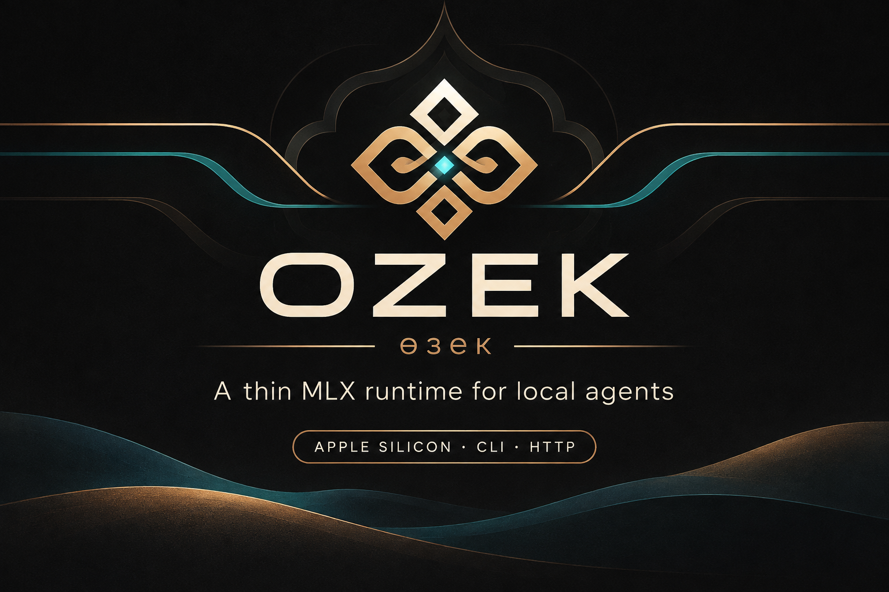

<p align="center">
  
</p>

# Ozek (өзек)

[](https://github.com/jaganov/ozek/actions/workflows/ci.yml)
[](https://github.com/jaganov/ozek)
[](https://www.python.org/downloads/)
[](#requirements)
[](LICENSE)

Kazakh **өзек** — core / stem / essence.

**A lightweight inference runtime for local AI agents on Apple Silicon.**

Ozek wraps [MLX](https://github.com/ml-explore/mlx) / [`mlx-lm`](https://github.com/ml-explore/mlx-lm) with a small Python API, CLI, and local HTTP server: load one model, generate or stream tokens, return metrics. Heavy compute stays in Metal kernels; Ozek handles control plane (sampler, stop, cancel, JSON helpers, YAML presets).

| | Larger local stacks | Ozek |
|---|---|---|
| Surface | chat UI, multi-model hubs | library + CLI + local HTTP |
| Backend | often llama.cpp (+ product layer) | **MLX** on Apple Silicon |
| Scope | full apps | one loaded model slot |

## Status

**Alpha** · `0.1.1` · unit CI on push/PR · live MLX smoke is local-only (`OZEK_LIVE=1`)

## Requirements

- Apple Silicon Mac (M1 / M2 / M3 / M4)
- Python 3.11+
- [`mlx-lm`](https://github.com/ml-explore/mlx-lm) (pulled in with install)

## Install

```bash
git clone https://github.com/jaganov/ozek.git
cd ozek
python3 -m pip install -e .
```

## CLI

```bash
ozek generate \
  --profile qwen25-3b-4bit \
  --prompt "Explain KV cache in one sentence." \
  --max-tokens 64

ozek generate --prompt "Hi" --json
ozek generate --prompt "..." --think
ozek generate --prompt "..." --stop "\n" --top-p 0.9 --top-k 40
ozek generate --prompt "Return city and country for Tokyo" \
  --response-json --schema '{"type":"object","properties":{"city":{"type":"string"},"country":{"type":"string"}}}' \
  --json-retries 1 --timeout 30 --seed 42

# Named presets from ozek.yml (cwd, $OZEK_CONFIG, or ~/.config/ozek/)
ozek config
ozek run summarize --prompt "KV cache in local LLMs"
ozek profiles
ozek info
```

### YAML presets (`ozek.yml`)

Example config ships in the repo root; you can also keep one at `~/.config/ozek/ozek.yml`.

```yaml
default_profile: qwen25-3b-4bit
server:
  host: 127.0.0.1
  port: 8787
presets:
  summarize:
    system: "Return concise JSON only."
    max_tokens: 256
    temperature: 0.2
    response_format: json
    schema: { type: object, properties: { summary: { type: string } } }
```

```bash
ozek run summarize --prompt "..."
ozek-server --config ozek.yml
# POST /v1/generate  { "preset": "summarize", "prompt": "..." }
# GET  /v1/presets
```

### Model profiles (16 GB Mac)

| Profile | Model | Notes |
|---|---|---|
| `qwen25-3b-4bit` (**default**) | Qwen2.5-3B Instruct 4-bit | Strong tok/s / RAM balance for agents |
| `qwen25-7b-4bit` | Qwen2.5-7B Instruct 4-bit | Higher quality, more memory |
| `qwen35-9b-4bit` | Qwen3.5-9B 4-bit | Heavier; watch memory pressure |

Any MLX / Hugging Face id works via `--model` / `"model"`.

## Python API

```python
from ozek import runtime

runtime.load("mlx-community/Qwen2.5-3B-Instruct-4bit")
result = runtime.generate(
    "Return city and country for Tokyo as JSON.",
    max_tokens=64,
    response_format="json",
    schema={
        "type": "object",
        "properties": {
            "city": {"type": "string"},
            "country": {"type": "string"},
        },
    },
)
print(result.parsed)       # e.g. {'city': 'Tokyo', 'country': 'Japan'}
print(result.parse_error)  # None when parse succeeded
```

## Server

Local HTTP API (stdlib). Default bind: `127.0.0.1:8787`.

```bash
ozek-server --model mlx-community/Qwen2.5-3B-Instruct-4bit --port 8787
```

| Method | Path | Notes |
|---|---|---|
| `GET` | `/health` | liveness + ready + busy |
| `GET` | `/v1/info` | model, busy, RSS, last generate summary, contract |
| `GET` | `/v1/contract` | documented field names + `finish_reason` values |
| `GET` | `/v1/profiles` | built-in model profiles |
| `GET` | `/v1/presets` | YAML named presets (when a config is loaded) |
| `POST` | `/v1/generate` | prompt + sampler + stop + optional `profile` / `preset` |
| `POST` | `/v1/chat/completions` | OpenAI-compatible subset; `stream: true` → SSE |
| `POST` | `/v1/cancel` | cancel in-flight generate |

`/v1/generate` body (all optional except `prompt`):

```json
{
  "prompt": "Return city and country for Tokyo.",
  "max_tokens": 64,
  "temperature": 0.0,
  "top_p": 0.9,
  "top_k": 40,
  "min_p": 0.0,
  "repetition_penalty": 1.1,
  "stop": ["\n", "###"],
  "system": "optional system prompt",
  "think": false,
  "response_format": "json",
  "schema": {"type": "object", "properties": {"city": {"type": "string"}, "country": {"type": "string"}}},
  "timeout_s": 30,
  "seed": 42,
  "json_retries": 1
}
```

`response_format` also accepts OpenAI-style `{"type":"json_object"}` / `{"type":"json_schema","json_schema":{"schema":{...}}}`.  
JSON mode uses a prompt nudge plus extraction (not constrained decoding). Responses may include `parsed` and `parse_error`.  
`json_retries` re-runs generate (with a repair nudge) when parse fails.

If the runtime slot is busy → **HTTP 503** `{ "code": "busy" }`.  
`finish_reason` values: `length` | `stop` | `cancel` | `eos` | `timeout`.  
SSE final chunk includes `ozek_finish_reason` (e.g. `cancel` / `timeout`) alongside OpenAI-style `finish_reason`.

```bash
curl -s http://127.0.0.1:8787/v1/generate \
  -H 'Content-Type: application/json' \
  -d '{"prompt":"Say hi in one word.","max_tokens":16,"stop":[" "]}'
```

## Features in `0.1.1`

| Area | What you get |
|---|---|
| Generate controls | temperature, top_p, top_k, min_p, repetition_penalty, stop sequences |
| Reliability | `timeout_s`, `seed`, `json_retries`; SSE `ozek_finish_reason` |
| Concurrency | single-flight slot; busy → error / 503; `cancel` |
| Structured output | `response_format=json` + optional schema → `parsed` / `parse_error` |
| Config | `ozek.yml` presets; `ozek run <preset>`; server `--config` |
| Observability | `/v1/info` — RSS, last tok/s / TTFT / finish_reason; `/v1/contract` |
| Profiles | documented 3B / 7B / 9B-class 4-bit defaults for ~16 GB Macs |

Ozek is **stateless** across turns: the caller keeps `messages[]` (and any tools / planners). Multi-turn memory and tool orchestration live in the agent, not in the runtime.

## Tests

```bash
# Offline unit suite (also runs on GitHub Actions — CI badge above)
python -m unittest discover -s tests -p 'test_unit.py' -v

# Optional live generate on Apple Silicon (loads the default model)
OZEK_LIVE=1 python -m unittest tests.test_live -v
```

CI installs **PyYAML only** and runs `test_unit.py` on Python 3.11–3.13. It does **not** install MLX or download models (those need a Mac).

## Performance (Apple M2 Pro, 16 GB)

Single-stream, warm-ish runs on one machine. Quantization, chat templates, and sampler defaults differ across stacks — treat this as orientation.

Workload: short prompt, `max_tokens=64`, thinking **off**.  
Model family: **Qwen2.5-3B Instruct**, 4-bit / Q4-class.

| Runtime | Backend | generation tok/s | decode tok/s (wall) | TTFT | Peak mem |
|---|---|---:|---:|---:|---:|
| **Ozek** | MLX (`mlx-lm`) | **78.5** | **73.3** | 0.58 s | 1.93 GB |
| Ollama | llama.cpp Metal (`qwen2.5:3b`) | 70.4 | 67.2 | **0.30 s** | — |

On this 3B run Ozek leads generation throughput; Ollama has lower TTFT (0.30 s vs 0.58 s).

Larger check (**Qwen3.5-9B**, 4-bit, thinking off):

| Runtime | generation tok/s | decode tok/s (wall) |
|---|---:|---:|
| **Ozek (MLX)** | **~35** | **~35** |
| Ollama | ~25 | ~26 |

## License

MIT — free to use, fork, and ship.
