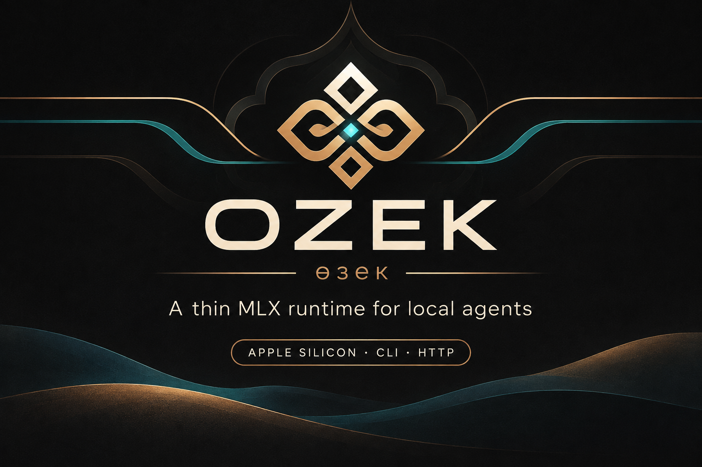

<p align="center">
  
</p>

# Ozek (өзек)

[](https://github.com/jaganov/ozek/actions/workflows/ci.yml)
[](https://github.com/jaganov/ozek)
[](https://www.python.org/downloads/)
[](#requirements)
[](LICENSE)

Kazakh **өзек** — core / stem / essence.

**A lightweight MLX inference runtime for local AI agents on Apple Silicon.**

### Who this is for

| You have… | Use |
|---|---|
| **Apple Silicon Mac** | **Ozek + MLX** — the fast local path on Mac |
| **NVIDIA GPU + Linux/Windows** | **CUDA** (llama.cpp / vLLM / Ollama) — usually the speed king there |
| Neither | Portable stacks (llama.cpp Vulkan/ROCm, etc.) — fine for compatibility, rarely the throughput leader |

**No Mac in the table below?** Ozek is not the tool you want — pick a CUDA stack on NVIDIA; it will typically be faster for you than forcing MLX elsewhere.

Ozek is the **Apple line**: one model slot on mini / Studio / MacBook, thin CLI + local HTTP on top of [MLX](https://github.com/ml-explore/mlx) / [`mlx-lm`](https://github.com/ml-explore/mlx-lm). Multi-Mac **Thunderbolt 5 RDMA** clustering is an MLX Distributed path for later — not required to use Ozek today.

### Apple Silicon lineup (MLX runs here)

Works on **Apple Silicon** (not Intel Mac), macOS **14+**, native arm64 Python. Newer chips and more unified memory → larger models and better tok/s.

| Generation | Chips | Notes |
|---|---|---|
| **M1** | M1 · M1 Pro · M1 Max · M1 Ultra | Entry point for MLX; base M1 is fine for small/mid models |
| **M2** | M2 · M2 Pro · M2 Max · M2 Ultra | Strong everyday local agents (e.g. 16 GB Pro class) |
| **M3** | M3 · M3 Pro · M3 Max · M3 Ultra | Ultra = big single-box memory pool |
| **M4** | M4 · M4 Pro · M4 Max | Pro/Max: Thunderbolt 5 on supported machines → future RDMA clusters |
| **M5+** | M5 · M5 Pro · M5 Max · M5 Ultra | Current top of the Mac local-LLM ladder |

**Where it shines:** Pro / Max / Ultra with **36–512 GB** unified memory — big open-weight models in one box without a discrete GPU.

On Mac, **MLX is the runtime to prefer for generation speed** vs llama.cpp Metal / Ollama-class stacks. Typical decode advantage is often about **~10–40%+** depending on model and chip (dense models nearer the low end; some MoE / archs much higher). Prefill/TTFT can still favor llama.cpp on long prompts. See [Performance](#performance-apple-m2-pro-16-gb) for one machine’s numbers.

| | Larger local stacks | Ozek |
|---|---|---|
| Surface | chat UI, multi-model hubs | library + CLI + local HTTP |
| Backend | llama.cpp / CUDA product layers | **MLX** on Apple Silicon |
| Scope | full apps or multi-OS | one loaded model slot on Mac |

## Status

**Alpha** · `0.1.1` · unit CI on push/PR · live MLX smoke is local-only (`OZEK_LIVE=1`)

## Requirements

- Apple Silicon Mac (**M1 → M5+**, any Pro / Max / Ultra variant)
- macOS 14.0+
- Python 3.11+ (native **arm64**)
- [`mlx-lm`](https://github.com/ml-explore/mlx-lm) (pulled in with install)

## Install

```bash
git clone https://github.com/jaganov/ozek.git
cd ozek
python3 -m pip install -e .
```

Optional personal config (gitignored — edit freely):

```bash
cp configs/ozek.example.yml ozek.yml
# LLM-jp presets instead:
# cp configs/llmjp.example.yml ozek.yml
```

Without a local file, Ozek falls back to `configs/ozek.example.yml` (Qwen 3B default).

## Models

Ozek loads **MLX-format** weights only (via [`mlx-lm`](https://github.com/ml-explore/mlx-lm)) — not GGUF from llama.cpp.

| Source | Example |
|---|---|
| Hugging Face / MLX Community id | `mlx-community/Qwen2.5-3B-Instruct-4bit` |
| Local folder (already downloaded) | `~/Models/Qwen2.5-3B-Instruct-4bit` |

```bash
# Hub id (downloads on first load)
ozek generate --model mlx-community/Qwen2.5-3B-Instruct-4bit --prompt "Hi"

# Local path — put absolute paths only in a gitignored ozek.yml / ozek.local.yml
ozek generate --model ~/Models/Qwen2.5-3B-Instruct-4bit --prompt "Hi"
```

**Cache when downloading from the Hub:** `~/.cache/huggingface/hub/`  
(override with `HF_HOME` or `HUGGINGFACE_HUB_CACHE`).

### Convert HF → MLX (`mlx_lm.convert`)

Ozek cannot load raw BF16 Hugging Face checkpoints or GGUF. Convert once with [`mlx-lm`](https://github.com/ml-explore/mlx-lm), then point `--model` at the output folder (or set it in your **local** `ozek.yml`).

```bash
python3 -m mlx_lm convert \
  --hf-path <org>/<model> \
  --mlx-path ~/Models/<model>-4bit \
  -q --q-bits 4 --q-group-size 64 \
  --trust-remote-code   # needed when the upstream ships custom tokenizer code
```

### Example: LLM-jp 4.1 8B Thinking

Built-in profiles use Hub MLX packs:

| Profile | Hub id |
|---|---|
| `llmjp41-8b-thinking-4bit` | [`andeniel/llm-jp-4.1-8b-thinking-4bit-mlx`](https://huggingface.co/andeniel/llm-jp-4.1-8b-thinking-4bit-mlx) |
| `llmjp41-8b-thinking-8bit` | [`andeniel/llm-jp-4.1-8b-thinking-8bit-mlx`](https://huggingface.co/andeniel/llm-jp-4.1-8b-thinking-8bit-mlx) |

```bash
cp configs/llmjp.example.yml ozek.yml
ozek generate --profile llmjp41-8b-thinking-4bit --prompt "こんにちは"
ozek run llmjp-short --prompt "空は青い？"
```

Or convert from official BF16 yourself: [`llm-jp/llm-jp-4.1-8b-thinking`](https://huggingface.co/llm-jp/llm-jp-4.1-8b-thinking), then set `default_model:` / preset `model:` in **gitignored** `ozek.yml` to that folder.

**Notes**

- **16 GB Mac:** prefer 8B **4-bit** for everyday use; **8-bit** when you want a higher-fidelity A/B lane.
- Thinking checkpoints may emit Harmony `<|channel|>analysis` / `final` blocks even without `--think`.
- Ozek’s `load()` passes `trust_remote_code=True` so LLM-jp’s custom tokenizer modules load without an interactive prompt.

### Harmony output (`thinking` / `final`)

LLM-jp thinking models wrap CoT in Harmony channels. Ozek always parses them when present.

**Default UX:** print the **final answer** only. Use `--raw` (or `final_only: false`) for full markup.

| Field / flag | Meaning |
|---|---|
| `thinking` | `<\|channel\|>analysis` body |
| `final` | `<\|channel\|>final` body (default display) |
| `raw` | Full model string with markers |
| `--reasoning-effort` | `low` \| `medium` \| `high` \| `off` (best-effort skip analysis) |
| `stop_after_final` | Stop decode when final channel closes (`finish_reason=final`) |

```bash
# Plain stdout: answer only (default)
ozek generate --prompt "空は青い？" --reasoning-effort low --max-tokens 256

# Full Harmony + thinking
ozek generate --prompt "空は青い？" --raw --json

ozek run llmjp-short --prompt "空は青い？"
```

Roadmap (KV guard, mixed quant, …): [`../docs/harness-roadmap.md`](../docs/harness-roadmap.md).

### Structured JSON (`--response-json` / `--schema`)

Yes — you can ask for a shape. This is **prompt nudge + extract**, not constrained decoding (the model can still fail; check `parsed` / `parse_error`).

```bash
ozek generate --prompt "東京の都市と国" --final-only \
  --response-json \
  --schema '{"type":"object","properties":{"city":{"type":"string"},"country":{"type":"string"}},"required":["city","country"]}' \
  --json-retries 1
```

In `ozek.yml` presets: `response_format: json` plus a `schema:` map. HTTP: `"response_format":"json"` or OpenAI-style `{"type":"json_schema","json_schema":{"schema":{...}}}`. JSON is extracted from the **final** channel when Harmony is present.

## CLI

```bash
ozek generate \
  --profile qwen25-3b-4bit \
  --prompt "Explain KV cache in one sentence." \
  --max-tokens 64

ozek generate --prompt "Hi" --json
ozek generate --prompt "..." --think
ozek generate --prompt "..." --reasoning-effort low
ozek generate --prompt "..." --raw
ozek generate --prompt "..." --stop "\n" --top-p 0.9 --top-k 40
ozek generate --prompt "Return city and country for Tokyo" \
  --response-json --schema '{"type":"object","properties":{"city":{"type":"string"},"country":{"type":"string"}}}' \
  --json-retries 1 --timeout 30 --seed 42

# Named presets (see Config below)
ozek config
ozek run summarize --prompt "KV cache in local LLMs"
ozek profiles
ozek info
```

### Config (`configs/` + local overrides)

| File | In git? | Role |
|---|---|---|
| `configs/ozek.example.yml` | yes | Get-started default (Qwen) |
| `configs/llmjp.example.yml` | yes | Optional LLM-jp Hub presets |
| `configs/local.example.yml` | yes | Template for machine-local paths |
| `ozek.yml` / `ozek.local.yml` / `configs/local.yml` | **no** (gitignored) | Your overrides — absolute model paths OK here |
| `~/.config/ozek/ozek.yml` | n/a | User-home config |

Search order: `--config` → `$OZEK_CONFIG` → `./ozek.local.yml` → `./ozek.yml` → `./configs/local.yml` → `~/.config/ozek/` → bundled `configs/ozek.example.yml`.

```bash
cp configs/ozek.example.yml ozek.yml   # then edit; never commit
ozek run summarize --prompt "..."
ozek-server --config ozek.yml
```

### Model profiles (16 GB Mac)

| Profile | Model | Notes |
|---|---|---|
| `qwen25-3b-4bit` (**default**) | Qwen2.5-3B Instruct 4-bit | Strong tok/s / RAM balance for agents |
| `qwen25-7b-4bit` | Qwen2.5-7B Instruct 4-bit | Higher quality, more memory |
| `qwen35-9b-4bit` | Qwen3.5-9B 4-bit | Heavier; watch memory pressure |
| `llmjp41-8b-thinking-4bit` | LLM-jp 4.1 8B Thinking 4-bit MLX | Hub pack; aliases `4bit` / `llmjp-4bit` |
| `llmjp41-8b-thinking-8bit` | LLM-jp 4.1 8B Thinking 8-bit MLX | Hub pack; aliases `8bit` / `llmjp-8bit` |

Any MLX / Hugging Face id works via `--model` / `"model"`.

## Python API

```python
from ozek import runtime

runtime.load("mlx-community/Qwen2.5-3B-Instruct-4bit")
result = runtime.generate(
    "Return city and country for Tokyo as JSON.",
    max_tokens=64,
    response_format="json",
    schema={
        "type": "object",
        "properties": {
            "city": {"type": "string"},
            "country": {"type": "string"},
        },
    },
)
print(result.parsed)       # e.g. {'city': 'Tokyo', 'country': 'Japan'}
print(result.parse_error)  # None when parse succeeded
```

## Server

Local HTTP API (stdlib). Default bind: `127.0.0.1:8787`.

```bash
ozek-server --model mlx-community/Qwen2.5-3B-Instruct-4bit --port 8787
```

| Method | Path | Notes |
|---|---|---|
| `GET` | `/health` | liveness + ready + busy |
| `GET` | `/v1/info` | model, busy, RSS, last generate summary, contract |
| `GET` | `/v1/contract` | documented field names + `finish_reason` values |
| `GET` | `/v1/profiles` | built-in model profiles |
| `GET` | `/v1/presets` | YAML named presets (when a config is loaded) |
| `POST` | `/v1/generate` | prompt + sampler + stop + optional `profile` / `preset` |
| `POST` | `/v1/chat/completions` | OpenAI-compatible subset; `stream: true` → SSE |
| `POST` | `/v1/cancel` | cancel in-flight generate |

`/v1/generate` body (all optional except `prompt`):

```json
{
  "prompt": "Return city and country for Tokyo.",
  "max_tokens": 64,
  "temperature": 0.0,
  "top_p": 0.9,
  "top_k": 40,
  "min_p": 0.0,
  "repetition_penalty": 1.1,
  "stop": ["\n", "###"],
  "system": "optional system prompt",
  "think": false,
  "final_only": true,
  "response_format": "json",
  "schema": {"type": "object", "properties": {"city": {"type": "string"}, "country": {"type": "string"}}},
  "timeout_s": 30,
  "seed": 42,
  "json_retries": 1
}
```

`response_format` also accepts OpenAI-style `{"type":"json_object"}` / `{"type":"json_schema","json_schema":{"schema":{...}}}`.  
JSON mode uses a prompt nudge plus extraction (not constrained decoding). Responses may include `parsed` and `parse_error`.  
`json_retries` re-runs generate (with a repair nudge) when parse fails.  
Harmony replies also expose `thinking` / `final` / `raw`; with `final_only: true`, `text` (and chat `content`) is the final channel.

If the runtime slot is busy → **HTTP 503** `{ "code": "busy" }`.  
`finish_reason` values: `length` | `stop` | `cancel` | `eos` | `timeout` | `final`.  
SSE final chunk includes `ozek_finish_reason` (e.g. `cancel` / `timeout`) alongside OpenAI-style `finish_reason`.

**LLM-jp profile aliases:** `"profile":"4bit"` or `"8bit"`. Response echoes `profile` + `stats.prefill_tps` / `decode_tps`.

**Context guard:** `max_context_tokens` (4096 in the example config for ~16 GB). Over budget → HTTP 400 `{ "code": "context_budget", ... }` — not silent swap.

```bash
curl -s http://127.0.0.1:8787/v1/generate \
  -H 'Content-Type: application/json' \
  -d '{"prompt":"Say hi in one word.","max_tokens":16,"stop":[" "]}'
```

## Features in `0.1.1`

| Area | What you get |
|---|---|
| Generate controls | temperature, top_p, top_k, min_p, repetition_penalty, stop sequences |
| Reliability | `timeout_s`, `seed`, `json_retries`; SSE `ozek_finish_reason` |
| Concurrency | single-flight slot; busy → error / 503; `cancel` |
| Structured output | `response_format=json` + optional schema → `parsed` / `parse_error` |
| Config | `configs/*.example.yml` + gitignored local `ozek.yml`; `ozek run <preset>` |
| Observability | `/v1/info` — RSS, last tok/s / TTFT / finish_reason; `/v1/contract` |
| Profiles | Qwen 3B/7B/9B + LLM-jp 8B thinking (4/8-bit Hub) for ~16 GB Macs |

Ozek is **stateless** across turns: the caller keeps `messages[]` (and any tools / planners). Multi-turn memory and tool orchestration live in the agent, not in the runtime.

## Tests

```bash
# Offline unit suite (also runs on GitHub Actions — CI badge above)
python -m unittest discover -s tests -p 'test_unit.py' -v

# Optional live generate on Apple Silicon (loads the default model)
OZEK_LIVE=1 python -m unittest tests.test_live -v
```

CI installs **PyYAML only** and runs `test_unit.py` on Python 3.11–3.13. It does **not** install MLX or download models (those need a Mac).

## Performance (Apple M2 Pro, 16 GB)

Single-stream, warm-ish runs on one machine. Quantization, chat templates, and sampler defaults differ across stacks — treat this as orientation.

Workload: short prompt, `max_tokens=64`, thinking **off**.  
Model family: **Qwen2.5-3B Instruct**, 4-bit / Q4-class.

| Runtime | Backend | generation tok/s | decode tok/s (wall) | TTFT | Peak mem |
|---|---|---:|---:|---:|---:|
| **Ozek** | MLX (`mlx-lm`) | **78.5** | **73.3** | 0.58 s | 1.93 GB |
| Ollama | llama.cpp Metal (`qwen2.5:3b`) | 70.4 | 67.2 | **0.30 s** | — |

On this 3B run Ozek leads generation throughput; Ollama has lower TTFT (0.30 s vs 0.58 s).

Larger check (**Qwen3.5-9B**, 4-bit, thinking off):

| Runtime | generation tok/s | decode tok/s (wall) |
|---|---:|---:|
| **Ozek (MLX)** | **~35** | **~35** |
| Ollama | ~25 | ~26 |

## License

MIT — free to use, fork, and ship.
